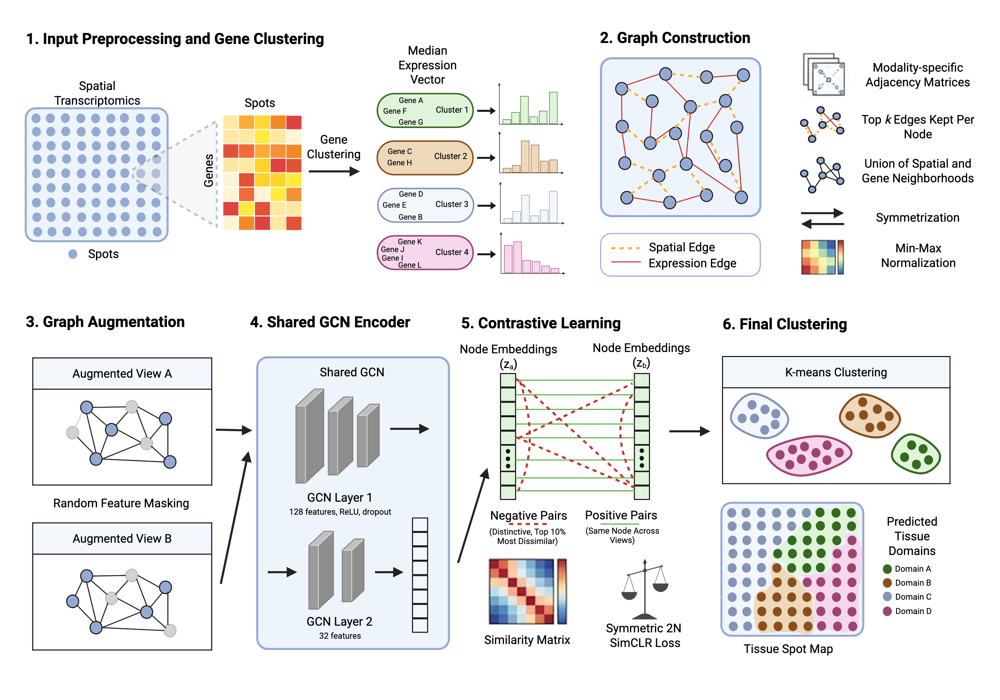

# STMExplorer: multi-view graph contrastive learning of spatial transcriptomics for tumor microenvironment discovery in colorectal cancer

STMExplorer is an automated, reproducible framework for tumor microenvironment (TME) discovery in colorectal cancer (CRC) using graph contrastive learning on spatial transcriptomics data.  At each training epoch, feature masking is used to generate two augmented views of the same graph. Both views are encoded by a shared two-layer GCN and optimized with a symmetric contrastive loss to learn low-dimensional node embeddings. Final embeddings are then obtained by encoding the full, unmasked feature matrix and are subsequently clustered using K-means and evaluated with standard clustering metrics.



## Requirements
* Python (>= 3.10)
* scikit-learn (>= 1.2)
* Python packages: anndata, scanpy, numpy, pandas, scipy, torch, torch_geometric

## Usage
Clone the repository or download source code files.

## Data 
The annotated spatial transcriptomics dataset utilized in this study is available through Zenodo at [https://zenodo.org/records/7760264](https://zenodo.org/records/7760264). The two unannotated datasets are available via the Gene Expression Omnibus (GEO) database under the accession codes of [GSE280313](https://www.ncbi.nlm.nih.gov/geo/query/acc.cgi?acc=GSE280313) and [GSE226997](https://www.ncbi.nlm.nih.gov/geo/query/acc.cgi?acc=GSE226997). Due to the size of the data, only one annotated sample (SN124_A595688_Rep2) is included in the repository for experiment replication.

## Preprocessing 
**Reference: ./preprocessing/**

The input .h5ad must contain raw counts in adata.X and spatial coordinates in adata.obsm["spatial"].

To run preprocessing use:

```
python3 -m preprocessing.preprocess --input data/sample.h5ad --output data/sample_preprocessed.h5ad
```

This saves the preprocessed .h5ad and generates the gene clusters.

## Run the model
**Reference: ./crc_tme/**

Replace the example paths with your file paths and set --n_clusters to the desired number of tissue groups. 

### For samples with annotations

```
python3 -m crc_tme.model --h5ad data/sample_preprocessed.h5ad --labels data/sample_annotations.csv --n_clusters 6 --k 10 --out_dir results/sample
```

The annotation CSV must contain Barcode and Pathologist Annotations columns. 

### For samples without annotations

```
python3 -m crc_tme.model --h5ad data/sample_preprocessed.h5ad --no_annotations --n_clusters 6 --k 10 --out_dir results/sample
```

### Performing an ablation experiment
**Reference: ./ablations/**

#### Feature selection experiments
To use HVGs instead of gene clusters, run:

```
python3 -m ablations.ablation --h5ad data/sample_preprocessed.h5ad --n_clusters 6 --features-mode hvg --hvg 2000
```

To use PCA instead, use the tags --features-mode pca and --pca-components 50.

#### Modality experiments

#### Optimal neighborhood size experiments

#### Contrastive pair selection experiments

#### Loss function experiments

#### Clustering algorithm experiments

## Contact
If you have any questions or problems, please send an email to erinw01 AT vt.edu

